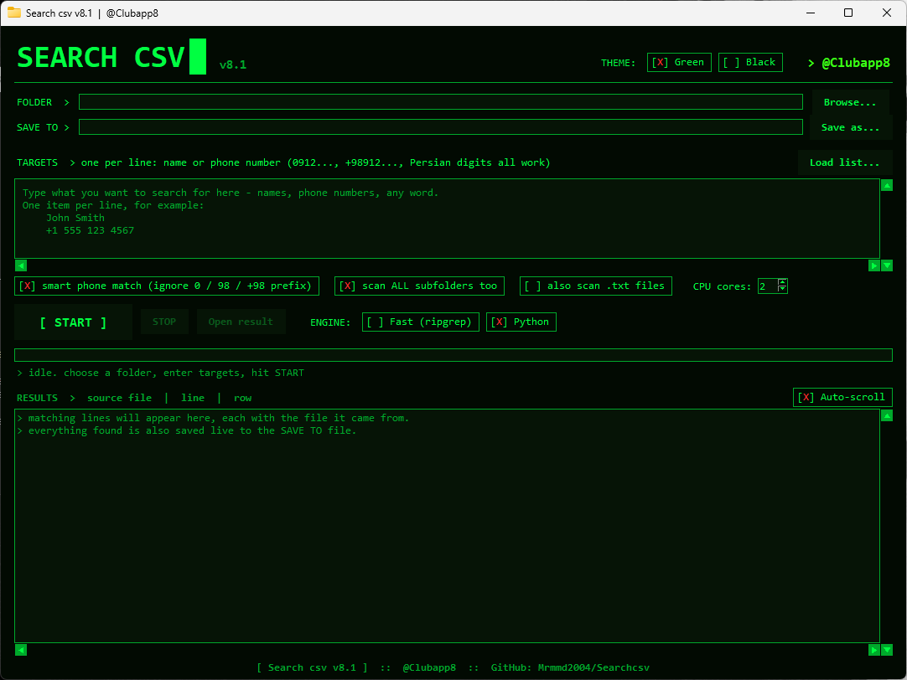

# Search csv

[English](#english) | [فارسی](#فارسی)

---

## English

Fast multi-file CSV search tool with a simple GUI. Current version: **v8.1**.

- Scans every `.csv` in a folder (and all subfolders, optional `.txt`)
- Search names or phone numbers, one per line (Persian digits work)
- Smart phone match: ignores `0` / `98` / `+98` prefixes
- Engine selector: **Fast (ripgrep)** or **Python**, multi-core (choose the number of CPU cores)
- Matching rows are shown live (source file | line | row) with optional auto-scroll, and saved live to one result CSV
- **START / STOP** buttons and **Open result** to jump straight to the saved file

## Download

Get the latest build from the **[Releases](../../releases/latest)** page:

| File | Description |
|---|---|
| `Search_csv_Setup_<ver>.exe` | Installer |
| `Search_csv_Portable_<ver>.exe` | Single portable exe, just double-click |
| `Search_csv_Portable_<ver>.zip` | Portable folder (settings stay next to the exe) |

Windows 10/11, 64-bit.

## Usage

1. Choose the **Folder** that contains your CSV files.
2. Type targets (one per line) or use **Load list...**
3. Pick the **Save to** file, the **Engine** and the number of **CPU cores**.
4. Press **START**. Results appear live and are saved to the **Save to** file; use **Open result** when done.

## License

Freeware, closed source. Free to use; redistribution of modified versions, reverse engineering and resale are not permitted. See [LICENSE](LICENSE).
Third-party notices: [THIRD_PARTY_NOTICES.md](THIRD_PARTY_NOTICES.md).

Contact: https://t.me/Clubapp8

---

## فارسی

# Search csv

ابزار جستجوی سریع در چندین فایل CSV با رابط گرافیکی ساده. نسخه‌ی فعلی: **v8.1**

- همه‌ی فایل‌های `.csv` داخل یک پوشه (و تمام زیرپوشه‌ها) را اسکن می‌کند؛ اسکن `.txt` هم اختیاری است
- جستجوی نام یا شماره تلفن، هر مورد در یک خط (ارقام فارسی هم کار می‌کند)
- تطبیق هوشمند شماره: پیش‌شماره‌های `0` / `98` / `+98` نادیده گرفته می‌شوند
- انتخاب موتور: **Fast (ripgrep)** یا **Python**، با پشتیبانی از چند هسته (تعداد هسته‌ی CPU قابل انتخاب است)
- ردیف‌های پیداشده همان لحظه (فایل منبع | خط | ردیف) با اسکرول خودکار اختیاری نمایش داده می‌شوند و زنده در یک فایل CSV ذخیره می‌شوند
- دکمه‌های **START / STOP** و **Open result** برای باز کردن مستقیم فایل نتیجه

### دانلود

آخرین نسخه را از صفحه‌ی **[Releases](../../releases/latest)** دانلود کنید:

| فایل | توضیح |
|---|---|
| `Search_csv_Setup_<ver>.exe` | نصب‌کننده |
| `Search_csv_Portable_<ver>.exe` | نسخه‌ی پرتابل تک‌فایلی، فقط دابل‌کلیک کنید |
| `Search_csv_Portable_<ver>.zip` | پوشه‌ی پرتابل (تنظیمات کنار برنامه می‌ماند) |

ویندوز ۱۰ و ۱۱، ۶۴ بیتی.

### نحوه‌ی استفاده

1. در بخش **FOLDER** پوشه‌ی حاوی فایل‌های CSV را انتخاب کنید.
2. موارد جستجو را (هر مورد در یک خط) بنویسید یا با **Load list...** از فایل بارگذاری کنید.
3. مسیر **SAVE TO**، موتور (**ENGINE**) و تعداد هسته‌ی CPU را انتخاب کنید.
4. دکمه‌ی **START** را بزنید. نتایج همان لحظه نمایش داده و در مسیر **SAVE TO** ذخیره می‌شوند؛ در پایان با **Open result** فایل را باز کنید.

### مجوز

نرم‌افزار رایگان (Freeware) و متن‌بسته (Closed source). استفاده رایگان است؛ توزیع نسخه‌های تغییرداده‌شده، مهندسی معکوس و فروش مجاز نیست. فایل [LICENSE](LICENSE) را ببینید.
اعلان‌های نرم‌افزارهای ثالث: [THIRD_PARTY_NOTICES.md](THIRD_PARTY_NOTICES.md)

ارتباط: https://t.me/Clubapp8

